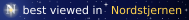
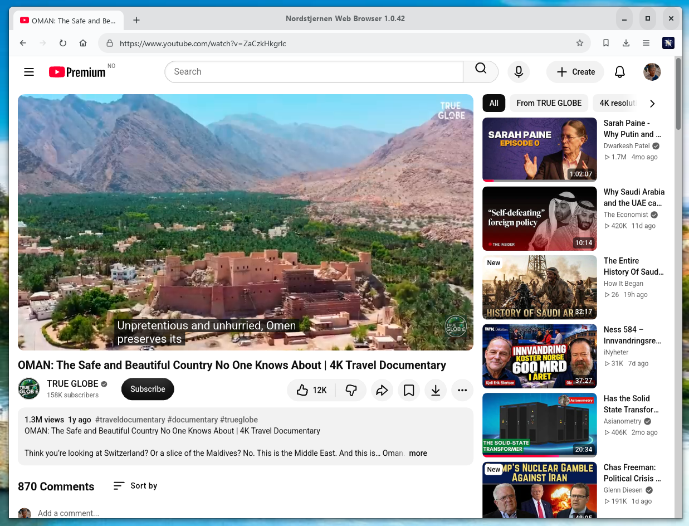

Nordstjernen web browser
========================

[](https://nordstjernen.org)
[](COPYING)
[](https://github.com/nordstjernen-web/nordstjernen-sol-browser/releases/latest)
[](https://www.npmjs.com/package/nordstjernen-browser)
[](https://pypi.org/project/nordstjernen-browser/)

Nordstjernen Sol is a web browser written from scratch in C, focused on
modern HTML, CSS and JavaScript standards.

**Windows:** install Nordstjernen Web Browser from the [Windows store](https://apps.microsoft.com/detail/9nw8t7w5z4pl).



**Current release:** **1.0.44** (November 2026) — see [Changelog.md](Changelog.md).

## Download

| Platform | Download |
|----------|----------|
| Windows 10 (1809 or later), x64 | [Microsoft Store](https://apps.microsoft.com/detail/9nw8t7w5z4pl) |
| Android 14 or later (arm64, x86_64) | [Google Play](https://play.google.com/store/apps/details?id=org.nordstjernen.WebBrowser) |
| macOS (Apple Silicon) | notarised `.dmg` on [GitHub Releases](https://github.com/nordstjernen-web/nordstjernen-sol-browser/releases) |
| Debian 13, Ubuntu 26.04, Fedora 45 | `.deb` and `.rpm` packages and a portable Linux `.zip` on [GitHub Releases](https://github.com/nordstjernen-web/nordstjernen-sol-browser/releases) |
| npm (Linux, macOS, BSD, Windows) | [`nordstjernen-browser`](https://www.npmjs.com/package/nordstjernen-browser), see below |
| Java/JVM | [`org.nordstjernen:nordstjernen-java`](https://github.com/nordstjernen-web/nordstjernen-sol-browser/packages) on GitHub Packages (Maven) |
| Alpine (musl), Arch, FreeBSD, NetBSD | build from source — see [docs/](docs/README.md) |

Packaging scripts for `.deb`, AppImage, RPM, Alpine, the BSDs, the macOS
`.dmg`, MSIX and the Windows installer are in `scripts/`; the Arch `PKGBUILD`
is in `packaging/arch/`.

### Install with npm

```sh
sudo npm install -g nordstjernen-browser
nordstjernen https://nordstjernen.org
```

Use `sudo` on Linux, macOS and the BSDs, where npm's global directory belongs
to root, but not on Windows. Apple Silicon Macs get the notarised release
build; everywhere else the package builds the release source against your
system's libraries (on Windows with MSYS2's UCRT64 toolchain) and first names
any build dependency that is missing. See [npm/README.md](npm/README.md).

### Install with pip

```sh
pip install nordstjernen-browser
nordstjernen https://nordstjernen.org
```

The first `nordstjernen` run puts the browser in place the same way as the
npm package, in your user data directory; `nordstjernen-install --remove`
deletes it again. See [pip/README.md](pip/README.md).

### Install with Homebrew (macOS)

```sh
brew install --cask nordstjernen-web/tap/nordstjernen
```

## Standards, security and size

**Standards.** Behaviour is measured against the spec text, section by
section, not against another browser. The walk-through of the in-scope WHATWG
HTML standard (§1–§16) in [docs/HTML-compatibility.md](docs/HTML-compatibility.md)
records **141 spec rows fully implemented, 31 partial, 0 absent** (July 2026),
besides a handful of non-goals by design: `embed`/`object` plugins,
`frame`/`frameset`, `applet`/`marquee`, telemetry, and AI-style web APIs.
The shared test suites, run locally:

| Suite | Passing |
|-------|---------|
| WPT `css/` (6,991 test files, October 2026) | 110,540 of 151,048 subtests (73.2 %) |
| WPT `html/`, `dom/`, `url/` and related (4,899 test files, October 2026) | 151,974 of 166,164 subtests (91.5 %) |
| [test262](https://github.com/tc39/test262) on the QuickJS engine (test262 of October 2026) | all 82,248 tests (0 failures) |

**Security.** Each tab's engine runs in its own renderer process behind an
IPC and shared-memory boundary. On Linux the renderer is sandboxed with
seccomp and Landlock (the UI shell with Landlock); on macOS a Seatbelt profile
confines its file writes to the profile, cache, download and temporary
directories; on Windows it runs with process mitigation policies (forced
ASLR, strict handle checks, restricted image loads, no child processes), and
the browser drops administrator rights at start-up. The FreeBSD and NetBSD
builds have no renderer sandbox yet. Neither the JavaScript nor the
WebAssembly engine has a JIT. An optional memory-safe Rust parser for the
renderer's IPC messages is built with `-Dipc_rust=enabled` (off by default),
and about:nordstjernen shows which parser and sandbox layers are active. See
[SECURITY.md](SECURITY.md).

**Minimalism.** The core engine is about 268,000 lines of project C and
headers, excluding vendored libraries and generated assets — small enough for
one person to read and audit end to end.
[docs/Software-Architecture.md](docs/Software-Architecture.md) maps the whole
system.

## Google Safe Browsing

Nordstjernen warns before it opens a site that
[Google Safe Browsing](https://safebrowsing.google.com/) lists as phishing,
malware or unwanted software. Every navigation and every redirect is checked
before the page loads, so a link in an email, a search result or an ad that
leads to a known attack site stops at a red warning page instead. The warning
names the kind of threat, and you can still go on to the site at your own
risk.

The check protects without sending your browsing to Google:

- **The lists live on your device.** In the background the browser downloads
  Google's lists of 4-byte hash prefixes for phishing (`se-4b`), malware
  (`mw-4b`) and unwanted software (`uws-4b`), and keeps them current at the
  pace Google asks for, about every 30 minutes. Each list is verified against
  Google's SHA-256 checksum before it is used.
- **Addresses are hashed locally.** The browser normalises the address,
  hashes its host and path combinations with SHA-256, and looks the prefixes
  up in the local lists.
- **Only a matching prefix leaves the device.** On a match, which is rare, the
  browser sends that 4-byte prefix to Google and compares the full hashes that
  come back. The address itself is never sent, and the request carries no
  cookies or account.
- **It fails safe for privacy, and open for availability.** When Google cannot
  be reached the page loads normally, and the local blocklist still applies.

A small built-in blocklist works alongside Google's, and you can add your own
hosts in `~/.config/nordstjernen/safebrowsing.list`. Safe browsing is on by
default and is switched off under Settings → Privacy → "Block dangerous
sites", which turns off both lists. about:nordstjernen shows whether Google
Safe Browsing is active, the size and update times of each list, and how many
addresses the current tab has checked, looked up and blocked.

Builds need a Safe Browsing API key, read from the `NS_SAFE_BROWSING_API_KEY`
environment variable when the browser is compiled; the official release
builds include one. A build without a key uses only the local blocklist.
Google Safe Browsing is offered for non-commercial use; see Google's
[terms](https://developers.google.com/safe-browsing/terms).

## Browser variants

| Browser | What it is | Downloads |
|---------|------------|-----------|
| **Nordstjernen Sol** (this repository) | the full browser: tabs in sandboxed renderer processes, builds for desktop and Android | [](https://github.com/nordstjernen-web/nordstjernen-sol-browser/releases) |
| [Northstar Web Browser](https://github.com/nordstjernen-web/northstar-web-browser) | the GPL-only minimalist edition: one process, one page per window | [](https://github.com/nordstjernen-web/northstar-web-browser/releases) |
| [Southstar](https://github.com/nordstjernen-web/southstar-browser) | this browser rewritten in Rust | [](https://github.com/nordstjernen-web/southstar-browser/releases) |


## Browser features

- **HTML and CSS** — HTML is parsed by the in-tree lexbor engine; XHTML, SVG
  and other XML documents go through an in-tree namespaced XML parser, and
  JSON and XML responses are shown pretty-printed. The CSS engine covers the
  modern cascade and CSSOM (`@layer`, `@scope`, nesting, `:has()`,
  `@property`), Media Queries Level 4, size container queries, flex, grid
  (with partial subgrid), multi-column, sticky positioning, scroll snap, 2D
  and 3D transforms, filters, masks and blend modes, transitions, animations,
  scroll-driven animations, CSS Color 4/5 and anchor positioning. Not yet:
  sideways block flow in vertical writing modes, painting
  `clip-path: path()`/`shape()`, and floats wrapping around `shape-outside`. See
  [docs/CSS-compatibility.md](docs/CSS-compatibility.md).
- **Text layout** — desktop builds shape text with web-text-lib, a Pango fork
  in `src/web-text-lib/` that caches shaped glyph strings and font metrics
  across layouts, so a run reaches HarfBuzz once instead of three times.
  Android uses the system Pango.
- **JavaScript** — the QuickJS interpreter: the in-tree quickjs-ng fork, with
  `Temporal`, the full `Intl` suite without ICU and `ShadowRealm`, or Fabrice
  Bellard's original QuickJS with `-Dquickjs=quickjs`
  ([docs/quickjs.md](docs/quickjs.md)). It runs the DOM, Shadow DOM, custom
  elements (including customized built-ins and `ElementInternals`), observer
  APIs, Canvas 2D (`Path2D`, `ImageBitmap`, `DOMMatrix`, `OffscreenCanvas`),
  WebCrypto over OpenSSL, the Navigation API, `window.open()` popups that
  message their opener, dedicated, module and shared Web Workers, Service
  Workers, Streams, IndexedDB over SQLite, WebSocket, `EventSource`, Web
  Animations, Fullscreen and Pointer Lock. Much of the higher-level Web API
  is a JavaScript prelude (`data/js/polyfills.js`) compiled into the binary.
- **Networking** — HTTP/2 over libcurl with HSTS, HTTPS-First (on by
  default), a Content Security Policy Level 2 subset, subresource integrity
  for scripts, CORS, mixed-content blocking, Fetch Metadata headers, cookies
  partitioned by top-level site (third-party cookies blocked by default),
  speculative subresource loading and a `Vary`-aware HTTP cache. HTTP, HTTPS
  and SOCKS proxies ([docs/Proxy.md](docs/Proxy.md)) and DNS-over-HTTPS are
  configurable.
- **Images and fonts** — Wuffs decodes PNG/APNG, GIF, BMP, JPEG and simple
  WebP; libwebp handles extended (alpha and animated) WebP; ICO and SVG are
  rendered in-engine; AVIF, JPEG XL and inline PDF (poppler) are optional.
  Web fonts load as TTF/OTF, WOFF and WOFF2.
- **Media** — `<video>` plays inline: MPEG-1 decoded in-tree by
  [pl_mpeg](https://github.com/phoboslab/pl_mpeg), WebM and Ogg (VP9, VP8,
  Theora, Opus, Vorbis) through FFmpeg's libav, and MP4 with H.264/AAC through
  the operating system's decoders (Media Foundation, VideoToolbox, MediaCodec,
  GStreamer), never a bundled one, using the GPU where available. MSE and
  `blob:` streaming, HLS and DASH through a built-in MSE player, and WebVTT
  `<track default>` subtitles work. `<audio>` plays MP3 and, with libav, WebM,
  Ogg and Opus. All audio plays through a separate `nordstjernen-audio` helper
  over SDL2. See [docs/media.md](docs/media.md).
- **Web Audio and capture** — `AudioContext`/`OfflineAudioContext` graphs are
  mixed in-engine by a simplified stereo renderer (no `AudioWorklet`);
  `getUserMedia` reaches the microphone and, on Linux, a V4L2 webcam, behind
  a per-site permission prompt.
- **WebGL, WebGPU and WebAssembly** — WebGL 1/2, on by default (WebGL 1 only
  on macOS, over OpenGL 4.1; [docs/webgl.md](docs/webgl.md)); experimental
  `navigator.gpu` over wgpu-native, on by default and switchable in Settings
  ([docs/webgpu.md](docs/webgpu.md)); the core WebAssembly JS API (MVP,
  reference types, bulk memory and SIMD) on a vendored WAMR interpreter
  ([docs/webassembly.md](docs/webassembly.md)).
- **MathML** — a minimalist presentation-MathML renderer for fractions,
  roots, scripts, under/over and tables, laid out inline on the text baseline.
- **Process per tab** — the GTK app is a thin shell that composites the
  shared-memory tiles each tab's sandboxed `nordstjernen-renderer` paints and
  forwards input over an HTTP/JSON control channel, so a page can't take down
  the UI ([docs/tab-isolation.md](docs/tab-isolation.md)). `--single-process`
  limits the browser to one tab and one renderer process
  ([docs/single-process-mode.md](docs/single-process-mode.md)). A watchdog
  restarts the browser after a crash or hang and reopens its tabs
  ([docs/watchdog.md](docs/watchdog.md)).
- **Privacy** — no telemetry or update pings. HTTPS-First, stripping of
  tracking parameters (`utm_*`, `gclid`, `fbclid`, …) and blocking of
  third-party cookies are on by default; Do Not Track and Global Privacy
  Control are opt-in. Safe browsing blocks known phishing and malware sites
  with Google Safe Browsing and a local blocklist (see
  [Google Safe Browsing](#google-safe-browsing)). Private tabs (`Ctrl+Alt+P`)
  and `--private` windows leave no cookies, HTTP cache or IndexedDB data
  behind ([docs/privacy-policy.md](docs/privacy-policy.md)).
- **UI** — tabs, bookmarks, history, downloads, find-in-page, zoom, full
  screen, light/dark/system themes, `view-source:`, printing and saving as PDF
  or PNG, Developer Tools (Console, Network, Performance, Layout and
  Elements), a Task Manager (`Shift+Esc`), recovery of open tabs after a
  crash, optional spell checking through Enchant, and a C embedding API
  ([docs/Embedding.md](docs/Embedding.md)). The UI follows the
  operating-system language: 40 catalogues translate the browser's name and
  13 also cover the core interface ([docs/i18n.md](docs/i18n.md)).
- **Automation** — `--headless` with `--dump=text|dom|layout|png:FILE|pdf:FILE`,
  `--eval=` and `--viewport=` drives the engine from scripts
  (`nordstjernen --help` lists the options). `nordstjernen --mcp` is a
  built-in MCP server that lets a local agent read and drive the browser
  window; it is off until allowed in Settings or with `--remote-control`,
  loopback only and token-authenticated
  ([docs/remote-control.md](docs/remote-control.md)).
- **Extensions** — initial support for simple, page-facing WebExtensions:
  content scripts, a slice of `browser.*`, and content blocking through
  static `declarativeNetRequest` rules and Adblock Plus/EasyList filter lists
  ([docs/extensions.md](docs/extensions.md)).
- **Java/JVM** — `org.nordstjernen.Nordstjernen` drives the engine from Java
  over JNI, or `RemoteBrowser`/`RemotePage` drive a separate renderer process
  so an engine crash can't take down the JVM. The fat jar is also a Swing
  browser (`java -jar nordstjernen-java.jar <url>`); JDK 21 is required. See
  [java/README.md](java/README.md).

## Build

On Debian and Ubuntu, `apt build-dep .` installs everything
`debian/control` lists, so no optional feature (AVIF, JPEG XL, H.264 video,
spell checking, PDF) is silently left out:

```sh
sudo apt install git
git clone https://github.com/nordstjernen-web/nordstjernen-sol-browser.git
cd nordstjernen-sol-browser
sudo apt build-dep .
meson setup builddir && meson compile -C builddir
./builddir/src/gtk/nordstjernen
```

Windows, Fedora, openSUSE, Arch Linux and macOS instructions are in
[docs/](docs/README.md); keyboard, mouse and touch controls are in
[docs/Controls.md](docs/Controls.md).

`meson install` also installs `open-browser-nordstjernen`, a link to
`nordstjernen`. The `.deb` and `.rpm` packages register it with
`update-alternatives`, and on Windows the installer and the MSIX package
register it as a command alias. It replaces the old `internet-browser` name.

## Dependencies

Nordstjernen is an independent engine — no upstream browser code.

**Vendored in-tree**, with no submodules:
[lexbor](https://github.com/lexbor/lexbor) (HTML parser, CSS and the WHATWG
URL module), [QuickJS](https://github.com/quickjs-ng/quickjs) (quickjs-ng
fork, no JIT), [WAMR](https://github.com/bytecodealliance/wasm-micro-runtime)
(WebAssembly interpreter), [Wuffs](https://github.com/google/wuffs)
(memory-safe image decoding), [pl_mpeg](https://github.com/phoboslab/pl_mpeg)
(MPEG-1 video and MP2 audio), [minimp3](https://github.com/lieff/minimp3)
(MP3) and web-text-lib (the Pango fork). Unless they are installed, the first
`meson setup` downloads two pinned subprojects:
[wgpu-native](https://github.com/gfx-rs/wgpu-native) for WebGPU, linked
statically (`-Dwebgpu=disabled` drops it), and the header-only
[SIMDe](https://github.com/simd-everywhere/simde) for WebAssembly SIMD
(`-Dwasm_simd=disabled` drops it). With both disabled the build needs no
network.

**Required system libraries:**

| Library | Min version | Role |
|---------|-------------|------|
| GTK 4 | **≥ 4.22.1 on Windows** (MSYS2 stock), ≥ 4.14 elsewhere (≥ 4.22 preferred) | UI toolkit, GSK renderer |
| GLib / GModule, Pango, cairo, HarfBuzz, FriBidi, fontconfig | (ship with GTK; web-text-lib needs GLib ≥ 2.80, cairo ≥ 1.18, HarfBuzz ≥ 8.3, FriBidi ≥ 1.0.6, fontconfig ≥ 2.15) | core types, dynamic module loading, text shaping, 2D drawing |
| libepoxy | — (with EGL on Linux) | OpenGL/ES function dispatch for WebGL |
| glslang | — (desktop; `-Dglslang=disabled` drops WebGL) | validates every WebGL shader before it reaches the GPU driver |
| libcurl | ≥ 8.5 (≥ 8.11 for WebSocket) | HTTP/2 networking, HSTS, native WebSocket (cookies are handled by the browser, see `docs/cookies.md`) |
| OpenSSL (libcrypto) | — | WebCrypto (`crypto.subtle`) |
| uchardet | — | charset detection |
| libpsl | — | public-suffix list for cookie scoping |
| SQLite | — | IndexedDB persistent storage |
| libwebp, libwebpdemux | — | extended (alpha and animated) WebP decoding |
| zlib | — | `CompressionStream` / `DecompressionStream` |
| FFmpeg libav\* | ≥ 6.0 (Linux, Windows; optional on macOS and the BSDs) | inline WebM/Ogg (VP9/VP8/Theora video, Opus/Vorbis audio) |
| libseccomp | — (Linux only) | renderer syscall sandbox |
| GStreamer | ≥ 1.20 (Linux; optional on the BSDs) | H.264/AAC, and VP9/AV1/HEVC in hardware through VA-API |

**Optional**, auto-detected or selected at build time: SDL2 (audio output and
microphone capture, `-Daudio`; without it the build is silent), FFmpeg libav\*
on macOS and the BSDs, GStreamer on the BSDs (`-Dgstreamer`), rustc (the
memory-safe IPC parser, `-Dipc_rust`), vorbisfile/opusfile (Ogg audio without
FFmpeg), brotli (`br` content encoding and WOFF2 fonts), zstd (`zstd` content
encoding), poppler-glib (inline PDF), libavif (`-Davif`), libjxl (`-Djxl`),
Enchant (spell checking), FreeType (WOFF/WOFF2 unpacking), wgpu-native where
it publishes no release (the BSDs, musl, Windows on Arm; WebGPU is not built
for Android) and Fabrice Bellard's original
[QuickJS](https://github.com/bellard/quickjs) (`-Dquickjs=quickjs`, fetched
through a meson wrap).

## License

Nordstjernen is dual-licensed: use it under **either** the Nordstjernen
Source License v1.0 **or** the GNU General Public License version 3 or later,
at your option (`LicenseRef-NSL-1.0 OR GPL-3.0-or-later`).

- **GPL-3.0-or-later** — free software: use, modify and redistribute it for
  any purpose, provided derivative works are also released under the GPL. See
  [COPYING](COPYING).
- **NSL-1.0** — use, modify and redistribute freely, except as a competing
  browser; each release becomes MIT after ten years. It is inspired by the
  [Functional Source License](https://fsl.software/).

See [License.md](License.md) for the full terms. Commercial licenses by
agreement. Bundled third-party components keep their own licenses
([THIRD-PARTY-LICENSES.md](THIRD-PARTY-LICENSES.md)).

# Development team
Nordstjernen is developed by a team located in Norway, Poland and Spain.  

Project home: <https://nordstjernen.org>  

[Join the Discord](https://discord.gg/4W959nW5vF)  

## Builds
[](https://github.com/nordstjernen-web/nordstjernen-sol-browser/actions/workflows/linux.yml)
[](https://github.com/nordstjernen-web/nordstjernen-sol-browser/actions/workflows/macos.yml)
[](https://github.com/nordstjernen-web/nordstjernen-sol-browser/actions/workflows/windows.yml)
[](https://github.com/nordstjernen-web/nordstjernen-sol-browser/actions/workflows/android.yml)
[](https://github.com/nordstjernen-web/nordstjernen-sol-browser/actions/workflows/java.yml)
[](https://github.com/nordstjernen-web/nordstjernen-sol-browser/actions/workflows/freebsd.yml)
[](https://github.com/nordstjernen-web/nordstjernen-sol-browser/actions/workflows/netbsd.yml)
[](https://github.com/nordstjernen-web/nordstjernen-sol-browser/actions/workflows/musl.yml)


----

Copyright 2026 Andreas Røsdal ·  
